# PulseOps

**Real-Time Distributed Observability & AI Incident Intelligence Platform.**

A portfolio project demonstrating backend/distributed-systems engineering:
Kafka event streaming, OpenTelemetry instrumentation, fault-tolerant
ingestion, anomaly detection, incident correlation, and an authenticated
management API + React dashboard. AI is a secondary, optional enrichment
feature, not the core architecture.

**Status: all 5 phases complete and verified.** See [Project phases](#project-phases)
for what was built in each.

## Architecture (current: Phase 5)

```mermaid
flowchart LR
    subgraph Demo["Demo services (FastAPI, OTel-instrumented)"]
        GW["gateway\nPOST /checkout"] -->|httpx, trace-propagated| ORD["orders\nPOST /orders"]
        ORD -->|httpx, trace-propagated| PAY["payments\nPOST /charge"]
    end

    GW -. OTLP/gRPC :4317 .-> OTEL["OTel Collector\n(otlp receiver -> batch -> kafkaexporter)"]
    ORD -. OTLP/gRPC :4317 .-> OTEL
    PAY -. OTLP/gRPC :4317 .-> OTEL

    OTEL -->|otlp_json, keyed by trace_id| RAW["Kafka topic\notel.raw.v1\n(3 partitions)"]

    RAW --> PROC["processor\n(pulseops-event-normalizer consumer group)\ndecode -> validate -> idempotent upsert"]
    PROC -->|malformed messages| DLQ["Kafka topic\notel.dlq.v1"]
    PROC -->|ON CONFLICT DO NOTHING on event_id| PG[("PostgreSQL\nevents, service_baselines,\nalerts, incidents, users")]

    PG --> DET["detector\n(10s sliding window, every 10s)\nerror-rate threshold + EWMA latency baseline"]
    DET -->|anomaly| ALERT["alerts table"]
    ALERT -->|correlate via trace_id overlap + dedup| INC["incidents table\n(open -> resolved)"]

    PG --> API["api\nJWT auth, pagination,\nRedis rate limiting, SSE, AI summary"]
    REDIS[("Redis\nrate-limit counters")] <-->|INCR/EXPIRE| API
    API -->|REST + SSE| DASH["dashboard\n(React + Vite, served by nginx)"]
    API -.->|optional| OPENAI(["OpenAI API\n(non-LLM fallback if no key)"])

    RAW -.->|Phase 1 smoke test only| SMOKE["kafka/smoke_test.py\n(throwaway consumer group)"]
```



Every demo-service request is a real HTTP call across three independent
FastAPI processes, trace-propagated end to end (W3C traceparent via
instrumented httpx), exported over OTLP/gRPC to an OpenTelemetry Collector,
which batches and exports spans as OTLP-JSON Kafka messages. A durable
consumer (`processor/`) then normalizes those spans into a versioned schema
and persists them to Postgres idempotently. A periodic `detector/` service
watches Postgres for sliding-window anomalies and correlates them into
incidents. An authenticated `api/` exposes that data (with Redis-backed rate
limiting and live SSE updates) to a React `dashboard/`.

## What's actually implemented

### Phase 1 -- infra, demo services, OTel -> Kafka ingestion

- `docker-compose.yml`: single-node KRaft Kafka (`apache/kafka:4.2.2`),
  Postgres 16, Redis 7, `otel/opentelemetry-collector-contrib:0.162.0`, and
  the three demo services, with health checks and named volumes.
- Three FastAPI services (`services/gateway`, `services/orders`,
  `services/payments`) forming a real call chain
  (`gateway -> orders -> payments`), each instrumented with the OpenTelemetry
  SDK (`FastAPIInstrumentor` + `HTTPXClientInstrumentor`), exporting traces
  over OTLP/gRPC. `/health` is excluded from tracing (see `docs/DECISIONS.md`
  -- Docker's healthchecks alone generated thousands of noise spans).
- Reproducible fault injection per service via `POST /admin/faults`
  (in-memory, per-process, unauthenticated): `latency_ms` /
  `latency_probability`, `error_probability` / `error_status_code`, and
  `outage` (immediate 503). All four traffic patterns required by the spec
  were manually verified against the running stack: normal traffic, a
  payments 5xx spike, injected latency, and a full payments outage that
  bubbles up through orders to the gateway as a 502.
- OTel Collector config (`infra/otel-collector/otel-collector-config.yaml`):
  `otlp` receiver (gRPC+HTTP) -> `memory_limiter`+`batch` processors ->
  `kafkaexporter` (encoding `otlp_json`, keyed by `trace_id`,
  `retry_on_failure` enabled) into `otel.raw.v1`.
- A real, executable smoke test (`kafka/smoke_test.py`, wrapped for pytest in
  `tests/phase1/test_smoke.py`) that drives an actual `/checkout` request
  through all three services, consumes `otel.raw.v1` with a throwaway
  consumer group, decodes OTLP-JSON, and asserts that gateway/orders/payments
  spans for that request exist, carry matching business-id attributes, and
  share one `trace_id` -- then separately verifies the payments-outage fault
  produces a 502 at the gateway.

### Phase 2 -- normalized event schema, durable persistence, idempotent consumer

- `processor/schema.py`: a versioned (`schema_version=1`) `NormalizedEvent`
  pydantic model (event ID, service, timestamp, trace ID, span ID, type,
  duration, status, severity, attributes), with real validation (blank IDs,
  end-before-start timestamps, etc. are rejected, not just typed-and-trusted).
- `processor/models.py` + Alembic migration (`processor/migrations/`):
  Postgres `events` table. `event_id` (`"{trace_id}:{span_id}"`) is a unique
  column and the idempotency key.
- `processor/consumer.py`: a real Kafka consumer group
  (`pulseops-event-normalizer`) reading `otel.raw.v1` with manual offset
  commits. Persistence is `INSERT ... ON CONFLICT (event_id) DO NOTHING`
  (idempotent upsert), wrapped in `tenacity` retry with exponential backoff
  for transient Postgres errors. Offsets are only committed after a
  message's events are durably persisted (or dead-lettered), so an
  at-least-once redelivery can never silently lose an event.
- Malformed messages (bad JSON, invalid span data) are produced to
  `otel.dlq.v1` with the original bytes and a reason header, and their
  offset is still committed -- a poison pill cannot block the partition.
- Three recovery scenarios actually exercised against the live stack
  (`tests/phase2/recovery_test.py`, 13/13 checks passing, also runs under
  pytest): **(1)** resetting the consumer group to earliest and replaying
  the entire topic reprocesses every message (proven via the processor's own
  logs) but inserts zero new rows; **(2)** a hand-crafted garbage Kafka
  message lands on the DLQ topic and the consumer group's lag still drains
  to zero afterward; **(3)** stopping Postgres, sending a real request, and
  confirming the processor retries and then crash-restarts (Docker's
  `restart: unless-stopped`) rather than dropping the event -- once Postgres
  comes back, the event is persisted exactly once with no duplicates.

### Phase 3 -- anomaly detection, incident correlation, fault-injection evaluation

- `detector/metrics.py`: sliding-window metrics per service, computed
  directly from Postgres. A "business request" is identified by the
  presence of an `http.route` attribute -- verified against real data that
  this cleanly isolates exactly one row per incoming HTTP request (not the
  ASGI send/receive sub-spans or outbound httpx client spans FastAPI's
  auto-instrumentation also emits).
- `detector/rules.py` (pure, unit-tested): two **explainable** anomaly
  rules, each skipped below `MIN_SAMPLES=3` to avoid single-request noise.
  **Error rate**: fixed threshold, flagged if more than 20% of a window's
  requests returned a 5xx. **Latency**: an EWMA baseline per service
  (`alpha=0.3`, persisted in `service_baselines`, survives detector
  restarts), flagged if the window's median latency exceeds
  `max(baseline * 2, 20ms floor)` -- the floor stops a near-zero cold-start
  baseline from flagging ordinary jitter as a 2x spike.
- `detector/correlate.py` (pure, unit-tested): alerts become incidents via
  two rules applied in order -- **(1) dedup**: a new alert with the same
  `(service, metric_type)` signature as an already-open incident, seen
  recently, attaches to it instead of opening a duplicate; **(2) cross-service
  correlation**: a new alert whose window shares a `trace_id` with an open
  incident's recent alerts gets merged into it. Alerts with no shared
  `trace_id` to anything open become their own incident -- this is what
  stops unrelated failures from being merged. Incidents auto-resolve after
  `RESOLUTION_GRACE_SECONDS=40s` with no new alerts.
- `detector/engine.py` + `detector/main.py`: a long-running service, one
  detection tick every 10 seconds, wired into `docker-compose.yml`.
- 15 deterministic unit tests (`tests/phase3/test_rules.py`,
  `test_correlate.py`) covering both rule modules with fabricated inputs,
  including the "avoid merging unrelated failures" property specifically
  (live traffic can't produce a genuinely unrelated failure, since the
  three demo services are always causally chained).
- A real fault-injection evaluation harness
  (`tests/phase3/evaluation.py`, 6/6 checks passing, also runs under
  pytest) driving labeled healthy/faulty windows through the **actual
  running detector service**: healthy traffic opens zero incidents; a
  sustained payments error-rate fault opens one `critical` incident
  correlated across all three services within the expected wait; that
  incident resolves once healthy traffic resumes and the grace period
  elapses; a separate sustained latency fault produces a distinct
  `latency`-type incident.

### Phase 4 -- authenticated management API, React dashboard, optional AI summaries

- `api/`: a FastAPI management service, separate from the three demo
  services. JWT auth (`PyJWT`, HS256) over a `users` table with `bcrypt`
  password hashing (`/auth/register`, `/auth/login`); every other route
  requires a valid bearer token (verified live: no token -> 401).
- Redis-backed rate limiting (`api/rate_limit.py`): a real fixed-window
  limiter (`INCR`/`EXPIRE`), shared state across the API's lifetime (not an
  in-process counter) -- verified live by hammering `/auth/login` past its
  5-per-60s limit and getting 429s with a `Retry-After`-style message.
- `GET /incidents` (paginated, filterable by `status`/`severity`),
  `GET /incidents/{id}` (detail with linked evidence -- actual `events` rows
  for the incident's alert `trace_ids`), `POST /incidents/{id}/acknowledge`,
  `GET /services/health`, `GET /services/{service}/latency-history`. Full
  OpenAPI docs at `/docs`.
- `GET /incidents/stream/live`: a real SSE endpoint (2s full-snapshot
  polling, not a diff -- a reconnecting client is correct immediately with
  no replay state to track). Authenticates via `?token=` query param rather
  than a bearer header, because browsers' native `EventSource` API cannot
  set custom headers -- discovered while wiring up the dashboard, not
  assumed going in (see `docs/DECISIONS.md`).
- `api/ai_summary.py`: incident summaries via OpenAI (`gpt-5-nano`), with
  verified evidence (the detector's own measured alert data) always kept
  structurally separate from the LLM's free-text "suspected cause," and a
  deterministic non-LLM fallback used automatically when no
  `OPENAI_API_KEY` is set. Untrusted data (`events.attributes`, which
  ultimately comes from HTTP request bodies) is wrapped in delimited
  `<untrusted_data>` tags with an explicit "describe, don't obey"
  instruction -- a basic prompt-injection defense. The endpoint never
  executes anything an LLM (or the untrusted input) returns; it only
  returns text. Tested live against the real OpenAI API with a real key
  (two real bugs found and fixed this way -- a `max_tokens` parameter
  rename and a reasoning-token budget that silently produced empty
  content; see `docs/DECISIONS.md`).
- `dashboard/`: a Vite + React + TypeScript SPA (no heavy UI framework,
  hand-rolled SVG sparkline instead of a charting library) -- login/register,
  a service-health panel, a filterable incident timeline, an incident
  detail view (alerts, linked evidence, acknowledge button, AI summary),
  and a live-updating header badge driven by the SSE stream with
  exponential-backoff reconnect. Built and served via `nginx:1.30-alpine`
  in `docker-compose.yml`.
- The full golden path (login -> service health -> incident list -> incident
  detail with evidence -> acknowledge status -> live SSE badge) was
  verified in an actual headless-Chromium browser, against both the Vite
  dev server and the production nginx-served Docker build, with zero
  console errors and zero 4xx/5xx network responses. Screenshots were
  inspected, not just text-scraped.

### Phase 5 -- tests, load benchmarks, CI on GitHub, security review

- `tests/phase4/api_test.py`: 21 live integration checks against the
  management API (auth, authorization enforcement, pagination/filtering,
  incident detail/evidence, acknowledge, rate limiting, and the SSE ticket
  flow -- including an explicit check that a normal long-lived bearer
  token is *rejected* if presented as an SSE ticket).
- `load/`: a real Locust load profile against the gateway's full
  `checkout -> orders -> payments` chain, a benchmark runner that records
  actual throughput/latency percentiles, Kafka consumer lag, and
  per-container CPU/memory, and a dedicated script measuring real lag
  growth/drain time when the processor is killed mid-load. Real numbers,
  real methodology, honestly-stated limitations: `docs/BENCHMARK_RESULTS.md`.
- **CI actually executed on GitHub's infrastructure** -- not just
  configured. This caught two real bugs no amount of local testing had:
  `docker compose wait kafka-init` only works on an already-running
  container (it had exited by the time that step ran, every time, and the
  command isn't just slow there, it errors); and Phase 2's replay-dedup
  test needed a stricter "processor is caught up" check for CI's
  back-to-back timing (a single `lag==0` reading doesn't account for
  OTel's batch span export delay). Both fixed, both verified, CI is green:
  https://github.com/Prabhas-1505/pulseops/actions.
- **Security review**: first review this codebase had. Two real,
  high-confidence findings, both fixed -- a hardcoded default JWT signing
  secret (the API now refuses to start on the placeholder value) and a
  long-lived bearer token sitting in the SSE stream's URL (replaced with a
  60-second, single-purpose ticket obtained via a new authenticated
  endpoint). Full writeup: `docs/DECISIONS.md`.

## Running it

```bash
cp .env.example .env
# Required: the api service refuses to start on the placeholder secret.
sed -i '' "s/^JWT_SECRET_KEY=.*/JWT_SECRET_KEY=$(openssl rand -hex 32)/" .env  # macOS
# sed -i "s/^JWT_SECRET_KEY=.*/JWT_SECRET_KEY=$(openssl rand -hex 32)/" .env  # Linux
docker compose up -d --build
```

This starts Kafka (KRaft, single node), Postgres, and Redis; runs
`kafka-init` (creates the two topics) and `migrate` (`alembic upgrade head`)
as one-shot jobs; starts the OTel Collector; then builds and starts
`payments`, `orders`, `gateway`, `processor`, `detector`, `api`, and
`dashboard` in dependency order. Service ports (host side, overridable via
`.env`): gateway `:8000`, orders `:8001`, payments `:8002`, management API
`:8080`, dashboard `:5173`.

Open **http://localhost:5173** and register an account to use the
dashboard. To enable the AI incident summary, put a real key in
`OPENAI_API_KEY` in `.env` before `docker compose up` -- leave it blank to
use the non-LLM fallback (no key required for the system to work).

**Postgres host port is `55432`, not `5432`** -- if your machine already
runs a native Postgres on `5432` (common on macOS), it silently intercepts
connections meant for the container. In-network traffic (the processor
talking to `postgres:5432`) is unaffected either way; this only matters for
host-side tooling (`psql`, `alembic`) -- see `docs/DECISIONS.md`.

Check everything is healthy:

```bash
docker compose ps
```

### Tests (Phases 1-4)

```bash
python3.11 -m venv .venv && source .venv/bin/activate
pip install -r kafka/requirements.txt -r processor/requirements.txt pytest redis

python kafka/smoke_test.py               # Phase 1, standalone, prints PASS/FAIL per check
pytest tests/phase1/test_smoke.py -v     # same, via pytest

python tests/phase2/recovery_test.py     # Phase 2, standalone
pytest tests/phase2/test_recovery.py -v  # same, via pytest

pytest tests/phase3/test_rules.py tests/phase3/test_correlate.py -v  # Phase 3, deterministic unit tests (fast, no stack needed)
python tests/phase3/evaluation.py        # Phase 3, live fault-injection harness (~2 min)
pytest tests/phase3/test_evaluation.py -v

python tests/phase4/api_test.py          # Phase 4, management API integration tests
pytest tests/phase4/test_api.py -v
```

The Phase 2 recovery tests actively stop/start the `postgres` and
`processor` containers as part of the scenarios; the Phase 3 evaluation
harness actively toggles `/admin/faults` on the live `payments` service --
don't run either against a stack holding data you care about. All of the
above were actually run against the live stack described here, and on
GitHub Actions CI (https://github.com/Prabhas-1505/pulseops/actions); see
the commands and output transcribed in `docs/ARCHITECTURE.md`.

### Load benchmarks

```bash
pip install -r load/requirements.txt
python load/run_benchmark.py --users 30 --spawn-rate 10 --run-time 90    # throughput/latency/resource usage
python load/failure_under_load.py --run-time 60 --outage-at 15 --outage-duration 15  # processor-outage-under-load
```

Real results from the last run of each: `docs/BENCHMARK_RESULTS.md`.

### Database migrations

```bash
export POSTGRES_HOST=localhost POSTGRES_PORT=55432 \
       POSTGRES_USER=pulseops POSTGRES_PASSWORD=change-me-in-local-env POSTGRES_DB=pulseops
alembic upgrade head                              # apply
alembic revision --autogenerate -m "description"  # create a new migration
```

### Manually driving traffic / fault injection

```bash
curl -X POST localhost:8000/checkout -H 'Content-Type: application/json' \
  -d '{"item":"demo","amount_cents":500}'

# 100% error rate on payments:
curl -X POST localhost:8002/admin/faults -H 'Content-Type: application/json' \
  -d '{"error_probability": 1.0, "error_status_code": 500}'

# reset:
curl -X POST localhost:8002/admin/faults/reset
```

### Management API, directly

```bash
curl -X POST localhost:8080/auth/register -H 'Content-Type: application/json' \
  -d '{"username":"demo","password":"supersecret123"}'
TOKEN=$(curl -s -X POST localhost:8080/auth/login -H 'Content-Type: application/json' \
  -d '{"username":"demo","password":"supersecret123"}' | python3 -c "import json,sys;print(json.load(sys.stdin)['access_token'])")

curl localhost:8080/incidents -H "Authorization: Bearer $TOKEN"
curl localhost:8080/services/health -H "Authorization: Bearer $TOKEN"
curl -N "localhost:8080/incidents/stream/live?token=$TOKEN"   # SSE
```

Full OpenAPI docs: http://localhost:8080/docs

### Dashboard dev mode (hot reload, outside Docker)

```bash
cd dashboard
npm install
npm run dev   # http://localhost:5173, talks to the API at localhost:8080 by default
```

### Inspecting incidents

```bash
PGPASSWORD=change-me-in-local-env psql -h localhost -p 55432 -U pulseops -d pulseops \
  -c "SELECT id, signature, affected_services, severity, status, opened_at FROM incidents ORDER BY id DESC LIMIT 10;"
```

## Project phases

1. **Infra, demo services, OTel -> Kafka ingestion, smoke test.** Done.
2. **Normalized event schema, Postgres persistence, idempotent consumer, DLQ wiring, recovery tests.** Done.
3. **Anomaly detection, incident correlation, fault-injection evaluation harness.** Done.
4. **Authenticated management API (JWT, rate limiting), React dashboard (SSE), optional AI incident summaries.** Done.
5. **Full test/benchmark suite, CI, security checks, final docs.** Done (this README).

See `docs/ARCHITECTURE.md` for component detail and verified run transcripts,
`docs/DECISIONS.md` for why specific versions/approaches were chosen (including
the full story behind every real bug found while building and testing this),
and `docs/BENCHMARK_RESULTS.md` for real, measured load-test results and
their methodology.
