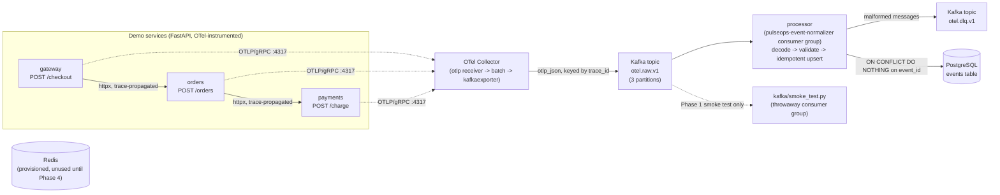

# PulseOps

**Real-Time Distributed Observability & AI Incident Intelligence Platform.**

A portfolio project demonstrating backend/distributed-systems engineering:
Kafka event streaming, OpenTelemetry instrumentation, fault-tolerant
ingestion, and (in later phases) anomaly detection, incident correlation,
and a management API + dashboard. AI is a secondary, optional enrichment
feature (Phase 4), not the core architecture.

**Status: Phase 2 of 5 complete and verified.** See [Project phases](#project-phases)
for what exists today vs. what's planned.

## Architecture (current: Phase 2)



Every demo-service request is a real HTTP call across three independent
FastAPI processes, trace-propagated end to end (W3C traceparent via
instrumented httpx), exported over OTLP/gRPC to an OpenTelemetry Collector,
which batches and exports spans as OTLP-JSON Kafka messages. A durable
consumer (`processor/`) then normalizes those spans into a versioned schema
and persists them to Postgres idempotently.

## What's actually implemented

### Phase 1 -- infra, demo services, OTel -> Kafka ingestion

- `docker-compose.yml`: single-node KRaft Kafka (`apache/kafka:4.2.2`),
  Postgres 16, Redis 7, `otel/opentelemetry-collector-contrib:0.162.0`, and
  the three demo services, with health checks and named volumes.
- Three FastAPI services (`services/gateway`, `services/orders`,
  `services/payments`) forming a real call chain
  (`gateway -> orders -> payments`), each instrumented with the OpenTelemetry
  SDK (`FastAPIInstrumentor` + `HTTPXClientInstrumentor`), exporting traces
  over OTLP/gRPC. `/health` is excluded from tracing (see `docs/DECISIONS.md`
  -- Docker's healthchecks alone generated thousands of noise spans).
- Reproducible fault injection per service via `POST /admin/faults`
  (in-memory, per-process, unauthenticated): `latency_ms` /
  `latency_probability`, `error_probability` / `error_status_code`, and
  `outage` (immediate 503). All four traffic patterns required by the spec
  were manually verified against the running stack: normal traffic, a
  payments 5xx spike, injected latency, and a full payments outage that
  bubbles up through orders to the gateway as a 502.
- OTel Collector config (`infra/otel-collector/otel-collector-config.yaml`):
  `otlp` receiver (gRPC+HTTP) -> `memory_limiter`+`batch` processors ->
  `kafkaexporter` (encoding `otlp_json`, keyed by `trace_id`,
  `retry_on_failure` enabled) into `otel.raw.v1`.
- A real, executable smoke test (`kafka/smoke_test.py`, wrapped for pytest in
  `tests/phase1/test_smoke.py`) that drives an actual `/checkout` request
  through all three services, consumes `otel.raw.v1` with a throwaway
  consumer group, decodes OTLP-JSON, and asserts that gateway/orders/payments
  spans for that request exist, carry matching business-id attributes, and
  share one `trace_id` -- then separately verifies the payments-outage fault
  produces a 502 at the gateway.

### Phase 2 -- normalized event schema, durable persistence, idempotent consumer

- `processor/schema.py`: a versioned (`schema_version=1`) `NormalizedEvent`
  pydantic model (event ID, service, timestamp, trace ID, span ID, type,
  duration, status, severity, attributes), with real validation (blank IDs,
  end-before-start timestamps, etc. are rejected, not just typed-and-trusted).
- `processor/models.py` + Alembic migration (`processor/migrations/`):
  Postgres `events` table. `event_id` (`"{trace_id}:{span_id}"`) is a unique
  column and the idempotency key.
- `processor/consumer.py`: a real Kafka consumer group
  (`pulseops-event-normalizer`) reading `otel.raw.v1` with manual offset
  commits. Persistence is `INSERT ... ON CONFLICT (event_id) DO NOTHING`
  (idempotent upsert), wrapped in `tenacity` retry with exponential backoff
  for transient Postgres errors. Offsets are only committed after a
  message's events are durably persisted (or dead-lettered), so an
  at-least-once redelivery can never silently lose an event.
- Malformed messages (bad JSON, invalid span data) are produced to
  `otel.dlq.v1` with the original bytes and a reason header, and their
  offset is still committed -- a poison pill cannot block the partition.
- Three recovery scenarios actually exercised against the live stack
  (`tests/phase2/recovery_test.py`, 13/13 checks passing, also runs under
  pytest): **(1)** resetting the consumer group to earliest and replaying
  the entire topic reprocesses every message (proven via the processor's own
  logs) but inserts zero new rows; **(2)** a hand-crafted garbage Kafka
  message lands on the DLQ topic and the consumer group's lag still drains
  to zero afterward; **(3)** stopping Postgres, sending a real request, and
  confirming the processor retries and then crash-restarts (Docker's
  `restart: unless-stopped`) rather than dropping the event -- once Postgres
  comes back, the event is persisted exactly once with no duplicates.

### Not yet implemented

Everything from Phase 3 onward: anomaly detection, incident correlation,
the authenticated management API, the React dashboard, and AI incident
summaries. Redis is provisioned in `docker-compose.yml` but nothing reads or
writes it yet (that's Phase 4 -- rate limiting). No load/benchmark numbers
exist yet -- see `docs/BENCHMARK_RESULTS.md`, which is intentionally a stub
until Phase 5.

## Running it

```bash
cp .env.example .env
docker compose up -d --build
```

This starts Kafka (KRaft, single node), Postgres, and Redis; runs
`kafka-init` (creates the two topics) and `migrate` (`alembic upgrade head`)
as one-shot jobs; starts the OTel Collector; then builds and starts
`payments`, `orders`, `gateway`, and `processor` in dependency order.
Service ports (host side, overridable via `.env`): gateway `:8000`, orders
`:8001`, payments `:8002`.

**Postgres host port is `55432`, not `5432`** -- if your machine already
runs a native Postgres on `5432` (common on macOS), it silently intercepts
connections meant for the container. In-network traffic (the processor
talking to `postgres:5432`) is unaffected either way; this only matters for
host-side tooling (`psql`, `alembic`) -- see `docs/DECISIONS.md`.

Check everything is healthy:

```bash
docker compose ps
```

### Smoke test (Phase 1) and recovery tests (Phase 2)

```bash
python3.11 -m venv .venv && source .venv/bin/activate
pip install -r kafka/requirements.txt -r processor/requirements.txt pytest

python kafka/smoke_test.py              # Phase 1, standalone, prints PASS/FAIL per check
pytest tests/phase1/test_smoke.py -v    # same, via pytest

python tests/phase2/recovery_test.py    # Phase 2, standalone
pytest tests/phase2/test_recovery.py -v # same, via pytest
```

The Phase 2 recovery tests actively stop/start the `postgres` and
`processor` containers as part of the scenarios -- don't run them against a
stack holding data you care about. All of the above were actually run
against the live stack described here; see the commands and output
transcribed in `docs/ARCHITECTURE.md`.

### Database migrations

```bash
export POSTGRES_HOST=localhost POSTGRES_PORT=55432 \
       POSTGRES_USER=pulseops POSTGRES_PASSWORD=change-me-in-local-env POSTGRES_DB=pulseops
alembic upgrade head                              # apply
alembic revision --autogenerate -m "description"  # create a new migration
```

### Manually driving traffic / fault injection

```bash
curl -X POST localhost:8000/checkout -H 'Content-Type: application/json' \
  -d '{"item":"demo","amount_cents":500}'

# 100% error rate on payments:
curl -X POST localhost:8002/admin/faults -H 'Content-Type: application/json' \
  -d '{"error_probability": 1.0, "error_status_code": 500}'

# reset:
curl -X POST localhost:8002/admin/faults/reset
```

## Project phases

1. **Infra, demo services, OTel -> Kafka ingestion, smoke test.** Done.
2. **Normalized event schema, Postgres persistence, idempotent consumer, DLQ wiring, recovery tests.** Done (this README).
3. Anomaly detection, incident correlation, fault-injection evaluation harness.
4. Authenticated management API (JWT, rate limiting), React dashboard (SSE), optional AI incident summaries.
5. Full test/benchmark suite, CI, security checks, final docs.

See `docs/ARCHITECTURE.md` for component detail and verified run transcripts,
`docs/DECISIONS.md` for why specific versions/approaches were chosen, and
`docs/BENCHMARK_RESULTS.md` for the (currently empty) benchmark methodology
and results template.
