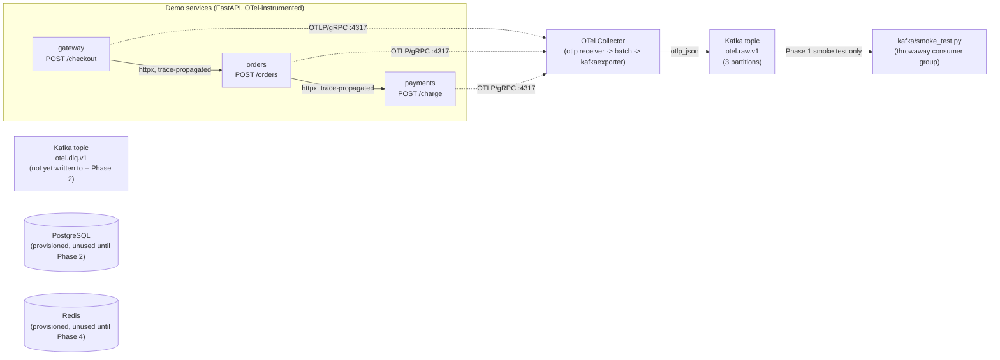

# PulseOps

**Real-Time Distributed Observability & AI Incident Intelligence Platform.**

A portfolio project demonstrating backend/distributed-systems engineering:
Kafka event streaming, OpenTelemetry instrumentation, fault-tolerant
ingestion, and (in later phases) anomaly detection, incident correlation,
and a management API + dashboard. AI is a secondary, optional enrichment
feature (Phase 4), not the core architecture.

**Status: Phase 1 of 5 complete and verified.** See [Project phases](#project-phases)
for what exists today vs. what's planned.

## Architecture (current: Phase 1)



Every demo-service request is a real HTTP call across three independent
FastAPI processes, trace-propagated end to end (W3C traceparent via
instrumented httpx), exported over OTLP/gRPC to an OpenTelemetry Collector,
which batches and exports spans as OTLP-JSON Kafka messages.

## What's actually implemented (Phase 1)

- `docker-compose.yml`: single-node KRaft Kafka (`apache/kafka:4.2.2`),
  Postgres 16, Redis 7, `otel/opentelemetry-collector-contrib:0.162.0`, and
  the three demo services, with health checks and named volumes.
- Three FastAPI services (`services/gateway`, `services/orders`,
  `services/payments`) forming a real call chain
  (`gateway -> orders -> payments`), each instrumented with the OpenTelemetry
  SDK (`FastAPIInstrumentor` + `HTTPXClientInstrumentor`), exporting traces
  over OTLP/gRPC.
- Reproducible fault injection per service via `POST /admin/faults`
  (in-memory, per-process, unauthenticated in Phase 1):
  `latency_ms` / `latency_probability`, `error_probability` /
  `error_status_code`, and `outage` (immediate 503). All four traffic
  patterns required by the spec were manually verified against the running
  stack: normal traffic, a payments 5xx spike, injected latency, and a full
  payments outage that bubbles up through orders to the gateway as a 502.
- OTel Collector config (`infra/otel-collector/otel-collector-config.yaml`):
  `otlp` receiver (gRPC+HTTP) -> `memory_limiter`+`batch` processors ->
  `kafkaexporter` (encoding `otlp_json`, `retry_on_failure` enabled) into
  `otel.raw.v1`.
- Kafka infra: `otel.raw.v1` (raw telemetry, 3 partitions) and `otel.dlq.v1`
  (dead-letter, 1 partition) are created by a `kafka-init` one-shot
  container. **`otel.dlq.v1` is not yet written to by anything** -- the
  collector's `retry_on_failure` only covers transient Kafka unavailability,
  not payload-level dead-lettering. Real DLQ semantics land in Phase 2's
  stream processor.
- A real, executable smoke test (`kafka/smoke_test.py`, wrapped for pytest in
  `tests/phase1/test_smoke.py`) that: drives an actual `/checkout` request
  through all three services, consumes `otel.raw.v1` with a throwaway
  consumer group, decodes OTLP-JSON, and asserts that gateway/orders/payments
  spans for that request exist, carry matching business-id attributes, and
  share one `trace_id` -- then separately verifies the payments-outage fault
  produces a 502 at the gateway.

### Not yet implemented

Everything from Phase 2 onward: the normalized event schema, durable
Postgres persistence, consumer-group idempotency/replay, anomaly detection,
incident correlation, the authenticated management API, the React dashboard,
and AI incident summaries. Postgres and Redis are provisioned in
`docker-compose.yml` but nothing reads or writes them yet. No load/benchmark
numbers exist yet -- see `docs/BENCHMARK_RESULTS.md`, which is intentionally
a stub until Phase 5.

## Running it

```bash
cp .env.example .env
docker compose up -d --build
```

This starts Kafka (KRaft, single node), runs `kafka-init` once to create the
two topics, starts the OTel Collector, then builds and starts `payments`,
`orders`, and `gateway` in that dependency order. Service ports (host side,
overridable via `.env`): gateway `:8000`, orders `:8001`, payments `:8002`.

Check everything is healthy:

```bash
docker compose ps
```

### Smoke test

```bash
python3.11 -m venv .venv && source .venv/bin/activate
pip install -r kafka/requirements.txt pytest
python kafka/smoke_test.py          # standalone, prints PASS/FAIL per check
# or:
pytest tests/phase1/test_smoke.py -v
```

Both were actually run against the live stack described above; see the
commands and output transcribed in `docs/ARCHITECTURE.md`.

### Manually driving traffic / fault injection

```bash
curl -X POST localhost:8000/checkout -H 'Content-Type: application/json' \
  -d '{"item":"demo","amount_cents":500}'

# 100% error rate on payments:
curl -X POST localhost:8002/admin/faults -H 'Content-Type: application/json' \
  -d '{"error_probability": 1.0, "error_status_code": 500}'

# reset:
curl -X POST localhost:8002/admin/faults/reset
```

## Project phases

1. **Infra, demo services, OTel -> Kafka ingestion, smoke test.** Done (this README).
2. Normalized event schema, Postgres persistence, idempotent consumer, DLQ wiring, recovery tests.
3. Anomaly detection, incident correlation, fault-injection evaluation harness.
4. Authenticated management API (JWT, rate limiting), React dashboard (SSE), optional AI incident summaries.
5. Full test/benchmark suite, CI, security checks, final docs.

See `docs/ARCHITECTURE.md` for component detail and verified run transcripts,
`docs/DECISIONS.md` for why specific versions/approaches were chosen, and
`docs/BENCHMARK_RESULTS.md` for the (currently empty) benchmark methodology
and results template.
